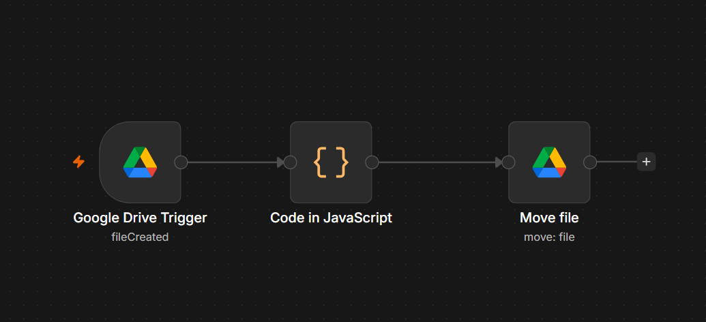
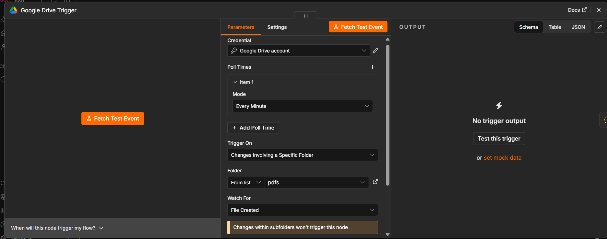
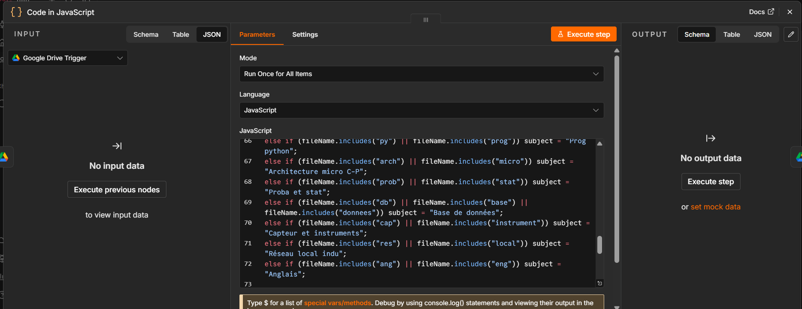
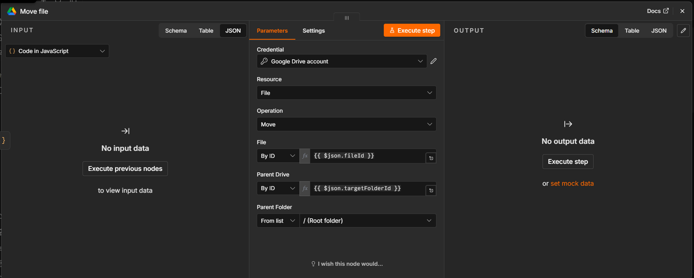

# 📚 Smart Academic Document Auto-Organizer (n8n & Google Drive)

## 🎯 The Problem
As students, we frequently capture photos of course materials, lectures, and assignments using our phones. Over time, these images accumulate, clutter our galleries, get mixed with personal photos, and become extremely difficult to locate when needed for studying. Manually sorting and organizing them into appropriate folders is tedious and inefficient.

## 💡 The Solution
An automated workflow built with **n8n** and **Google Drive** that solves this completely. Instead of manual sorting, you simply scan your documents into PDFs from your phone, name them with the subject keyword, and the system automatically routes them to their exact subject folder in the cloud!

---

📱 How It Works (User Guide)

1. **Create the Trigger Folder:** Set up a specific folder in your Google Drive (e.g., `Inbox` or `Scan_Folder`) to act as your upload trigger.
2. **Scan & Upload:** Open Google Drive on your phone,open the folder, tap the `+` button, select **Scan**, take photos of your course materials or assignments, and save them as a PDF.
3. **Smart Naming:** Name the file with a clear keyword related to your subject (e.g., writing `python_notes.pdf` or `db_assignment.pdf`).
4. **Automatic Organization:** The n8n automation detects the new file instantly, reads its name via custom JavaScript logic, and moves it to the correct subject folder automatically!

---

## ⚙️ Workflow Architecture
* **Trigger:** Google Drive (Watching for new files in the upload folder)
* **Processing Node:** n8n Code Node (JavaScript logic for keyword detection and folder mapping)
* **Action Node:** Google Drive (Dynamic file transfer to the target subject folder)
* This is how workflow look like.



add the Google Drive Trigger and  link your google drive account:
in the folder fieldes select the folde you will upload your files




Code Nodes: 



Move Node:



---

## 🛠️ Core JavaScript Logic
Here is the core script utilized inside the n8n Code node to parse file names and map them to their respective subject folder IDs:

```javascript
// Get the file name from the previous node and convert it to lowercase for easy matching
const fileName = $input.first().json.name.toLowerCase();

// Initialize default values
let subject = "General";
let targetFolderId = "DEFAULT_MAIN_FOLDER_ID"; // Fallback general folder ID (random file will be  added here)

// Map of main subjects to their respective Google Drive Folder IDs (ID is th last part of the folder URL)
const mainFolders = {
  "Graphes et opt": "ID_Graphes_et_opt",
  "Techno multimedia": "ID_Techno_multimedia",
  "Méth conc logiciel": "ID_Meth_conc_logiciel",
  "P.O.O": "ID_POO",
  "Gestion d'entreprise": "ID_Gestion_entreprise",
  "Prog python": "ID_Prog_python",
  "Architecture micro C-P": "ID_Architecture_micro_CP",
  "Proba et stat": "ID_Proba_et_stat",
  "Base de données": "ID_Base_de_donnees",
  "Capteur et instruments": "ID_Capteur_et_instruments",
  "Réseau local indu": "ID_Reseau_local_indu",
  "Anglais": "ID_Anglais"
};

// Identify the academic subject based on keywords in the file name
if (fileName.includes("graph") || fileName.includes("opt")) subject = "Graphes et opt";
else if (fileName.includes("multi") || fileName.includes("techno")) subject = "Techno multimedia";
else if (fileName.includes("meth") || fileName.includes("logiciel")) subject = "Méth conc logiciel";
else if (fileName.includes("poo") || fileName.includes("oop")) subject = "P.O.O";
else if (fileName.includes("gest") || fileName.includes("entreprise")) subject = "Gestion d'entreprise";
else if (fileName.includes("py") || fileName.includes("prog")) subject = "Prog python";
else if (fileName.includes("arch") || fileName.includes("micro")) subject = "Architecture micro C-P";
else if (fileName.includes("proba") || fileName.includes("stat")) subject = "Proba et stat";
else if (fileName.includes("db") || fileName.includes("base") || fileName.includes("donnees")) subject = "Base de données";
else if (fileName.includes("capt") || fileName.includes("instrument")) subject = "Capteur et instruments";
else if (fileName.includes("reseau") || fileName.includes("local")) subject = "Réseau local indu";
else if (fileName.includes("ang") || fileName.includes("eng")) subject = "Anglais";

// Retrieve the corresponding folder ID if the subject exists in the map
if (mainFolders[subject]) {
  targetFolderId = mainFolders[subject];
}

// Return the structured JSON output for the next node
return [{
  json: {
    fileName: $input.first().json.name,
    subject: subject,
    fileId: $input.first().json.id,
    targetFolderId: targetFolderId
  }
}];
}];
```

✨ Key Benefits

Zero Clutter: Eliminates lost study notes and unorganized files in phone galleries.

Fully Automated: Operates seamlessly in the background.

Real-World Application: Bridges mobile productivity (scanning notes) with cloud automation.
